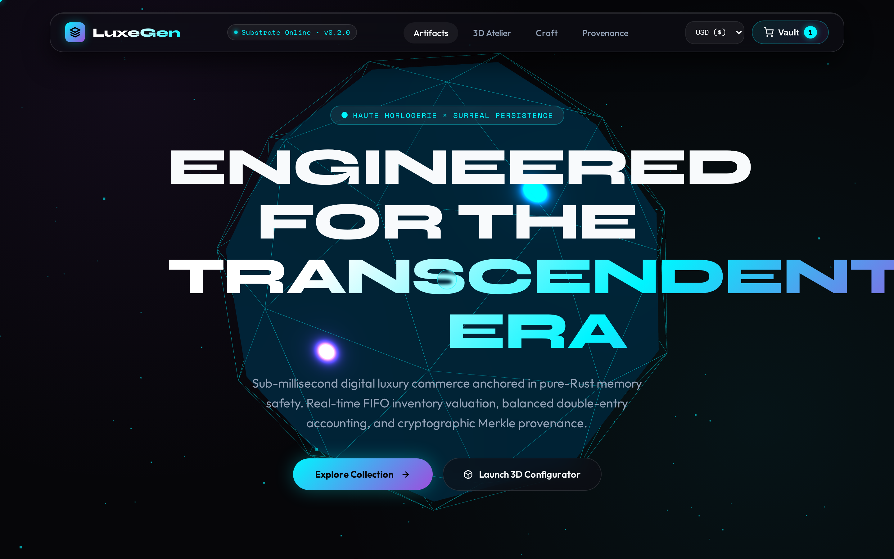
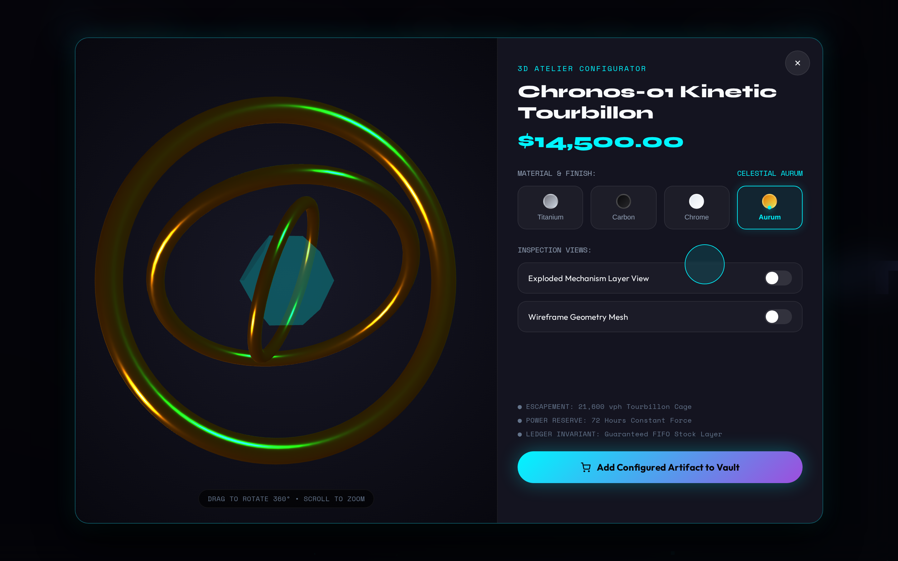
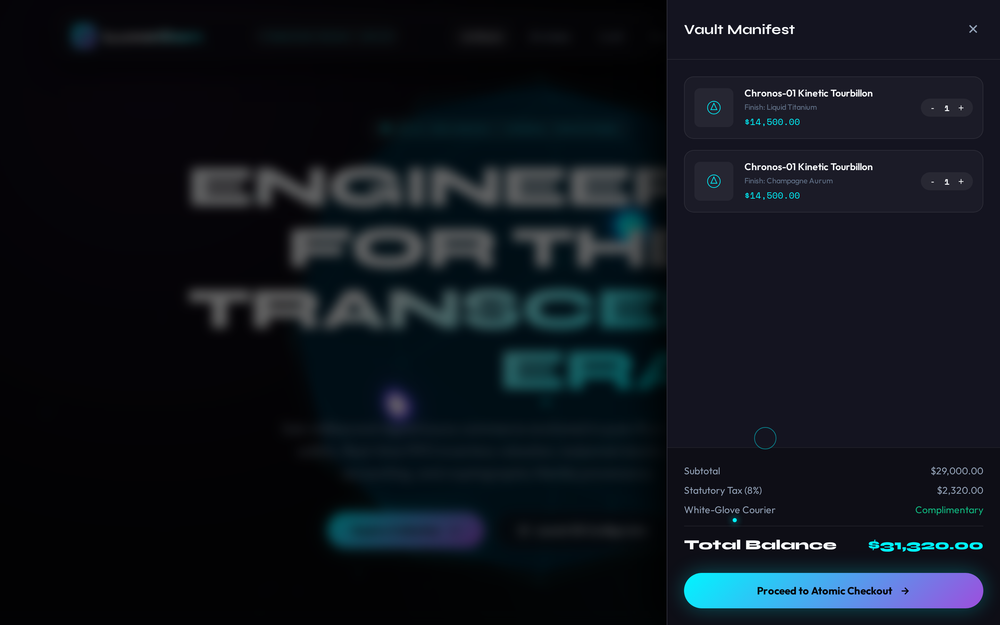
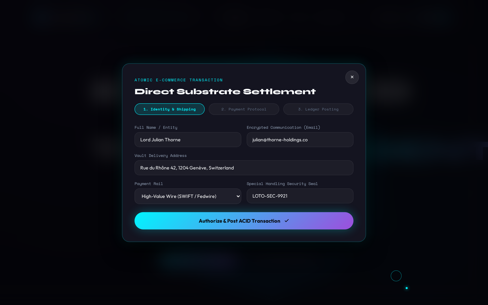
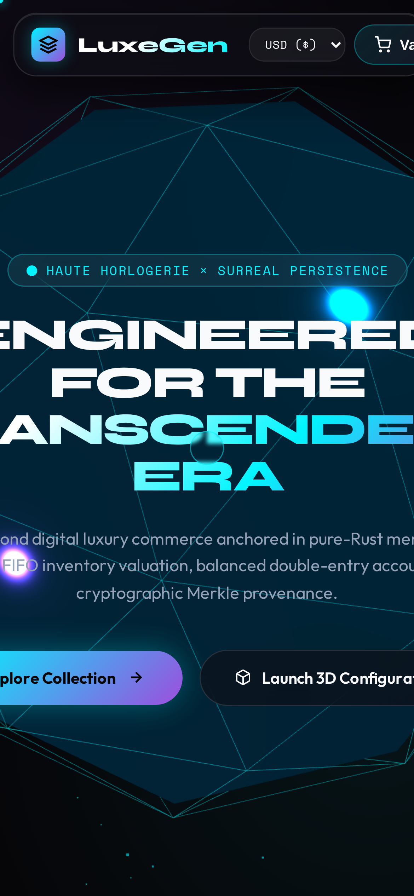

# `rustnext` — The Pure-Rust Enterprise Resource Planning & Operating Substrate

Next-generation, ultra-high-throughput, memory-safe rewrite of Frappe and ERPNext in pure Rust. Engineered for sub-millisecond transaction speeds, strict multi-tenant isolation, local-first offline resilience, and planetary-scale operational autonomy.

---

## 🏛 The Three Architectural Pillars

1. **Networking Substrate — [Actix-web](https://actix.rs):** Multi-tenant HTTP/1.1, HTTP/2, HTTP/3, and WebSocket actor dispatchers with in-process automated ACME TLS certificate negotiation, scoped session isolation, and zero-copy streaming.
2. **Persistence Core — [SurrealDB](https://surrealdb.com):** Embedded multi-model engine managing relational schemata, document graphs, bitemporal audit trails, and vector embeddings in a unified storage fabric.
3. **Reactive Universal Client — [Dioxus](https://dioxuslabs.com):** Cross-platform desktop, web, and mobile user interfaces powered by fine-grained signals, declarative form schemas, Gantt charts, SPC control viewers, and 3D warehouse layouts.

---

## 📦 Workspace Crate Topology

The workspace comprises 26 modular, high-performance crates structured across infrastructure, meta-modeling, business modules, user interfaces, and verification harnesses:

```
ERPNext_workspace/
├── crates/
│   ├── frappe-meta/         # DocType schema engine, dynamic SurrealQL DDL compiler, RBAC, Custom Fields, Hooks, Registry
│   ├── frappe-framework/    # Document lifecycle state machines, Rhai & WASI 0.2 Wasmtime sandbox, AI tool dispatcher
│   ├── frappe-storage/      # SurrealDB 3.3 multi-model driver, CRDT vector clocks/LWW, deduplicated drive, envelope encryption
│   ├── frappe-net/          # Micro-mode topology, ACME gateway, multi-tenant router, live WebSocket actor, HTTP/3 gateway
│   ├── erp-accounting/      # Double-entry ledger, multi-currency, printable document engine, payment gateway & GL settlement, Benford guard
│   ├── erp-inventory/       # Real-time stock ledgers, warehouse bin balancing, FIFO batch queues, serial tracking
│   ├── erp-manufacturing/   # Multilevel BOM explosions, routing, MRP capacity, MILP job shop scheduler, SPC control charts
│   ├── erp-trade/           # Pricing rules, metered billing, landed cost, 3-way invoice matching, WooCommerce migration
│   ├── erp-ppm/             # Critical Path Method (CPM/CCPM), ANSI/EIA-748 EVMS, 100k Monte Carlo risk simulator
│   ├── erp-wms/             # 3D slotting optimization, TSP pick paths, VDA 5050 AMR fleet dispatch, GS1 SSCC-18
│   ├── erp-asset/           # Linear Referencing (LRS), Weibull reliability & RUL degradation, cryptographic PTW & LOTO
│   ├── erp-software/        # ASC 606 revenue recognition, graduated SaaS subscription tiers, SLA penalty ledger
│   ├── erp-hr/              # Employee directory, biometric attendance logs, leave applications, payroll processing
│   ├── erp-crm/             # Lead acquisition pipelines, deal tracking, weighted opportunity conversion scoring
│   ├── erp-quality/         # Inspection readings, templates, Non-Conformance Reports (NCR), CAPA remediation
│   ├── erp-support/         # SLA timers, escalation matrices, support gameplans
│   ├── erp-lending/         # Loan portfolios, reducing/compound interest accrual, amortization schedules
│   ├── erp-learning/        # Course syllabi, student enrollment tracking, quiz assessment engines
│   ├── erp-cms-core/        # Bare-metal #![no_std] edge CMS core, 63-byte AudioPlaybackPacket, CRC16-CCITT
│   ├── erp-cms/             # Visual Block Canvas AST, <10ms SSR, OTT Video & Master Audio Streaming CMS
│   ├── erp-scanner/         # High-throughput barcode, QR code, and hardware scanner ingestion pipeline
│   ├── erp-importer/        # High-volume batch data importer with type coercion and transactional rollback
│   ├── erp-stealth-scraper/ # Resilient, distributed market data and catalog synchronizer
│   ├── erpnext-plugin-sdk/  # Third-party app extension SDK with WASM/WASI plugin interface and DocType bindings
│   ├── desk-components/     # Reactive Dioxus v7 UI components, desk shell SSR, List & Form views, dynamic forms, Gantt & SPC
│   ├── desk-app/            # Unified multi-persona desktop & mobile shell application (Desk, Portal, Kiosk, MES, Approvals, Admin)
│   └── rbench/              # CLI bench equivalent: site provisioning, schema migrations, load generator, benchmarks
└── docs/                    # Architectural charter, PRD, and TDD specifications
```

---

## 🚀 The 10 Architectural Epochs

- **Epoch I: Sub-64MB Micro-Topology & In-Process ACME**
  - Instant boot with `--micro` configuration (8MB write buffer, 16MB read cache, bounded 1024-entry queues).
  - Automated Let's Encrypt / ACME TLS certificate lifecycle management and multi-tenant domain routing.
  - Strict tenant session scoping (`resolve_scoped_session`, `TenantContext`) with zero cross-tenant contamination.

- **Epoch II: Dynamic Document Bus & Lock-Free Sequence Generators**
  - Zero-allocation `DynamicDocument` container utilizing `SmallVec<[_; 16]>` on the stack with `DocValue` enum.
  - Dynamic SurrealQL schema compilation (`compile_to_surrealql`) with index management and permission expressions.
  - Lock-free autoname sequence parsing (`NamingSeriesParser`) with sub-millisecond atomic statement formatting.

- **Epoch III: Multi-Book GL, SIMD FIFO & Benford Fraud Engine**
  - Multi-book double-entry accounting enforcing the zero-drift balance invariant: $\sum \text{Debit} - \sum \text{Credit} = 0$.
  - High-throughput FIFO inventory cost valuation queue with exact decimal precision.
  - Real-time statistical fraud detector (`BenfordGuard`) computing Chi-Square goodness-of-fit against Benford's Law.

- **Epoch IV: Advanced Project Portfolio & Manufacturing Intelligence**
  - Dual-engine CPM/CCPM project scheduling and ANSI/EIA-748 Earned Value Management System (CPI, SPI, EAC, TCPI).
  - 100k-iteration Monte Carlo risk simulation supporting Beta-PERT, Triangular, and Normal distributions.
  - Mixed-Integer Linear Programming (MILP) job shop scheduling and Statistical Process Control (SPC) with Nelson rule detection.
  - VDA 5050 AMR robot fleet dispatch, GS1 SSCC-18 handling units, Linear Referencing Systems (LRS), and PTW/LOTO safety interlocks.

- **Epoch V: Visual Block Canvas, OTT Video & Audio Streaming CMS**
  - Declarative reversible `PageBlock` and `CanvasBlockTree` AST supporting slot containers, responsive breakpoint cascades, and dynamic two-way SurrealQL DocType data bindings.
  - Pre-allocated zero-allocation SSR HTML compilation (`SsrEngine`) delivering $<10\text{ms}$ TTFB with Emdash editorial studio publishing.
  - Full-stack OTT Video Delivery Network: HLS v6 / CMAF variants, SCTE-35 SSAI manifest stitcher, 24/7 FAST linear EPG channels, Stremio v1 addon, and playhead Video X-Ray metadata.
  - Master Audio Streaming CMS: Lossless FLAC pipeline, 10-band ISO equalizer with safety preamp attenuation, syllable/karaoke LRC parser, transcript TF-IDF & Camelot harmonic music recommendation engine, EBU R128 loudness normalizer, SoundCloud scrub bar waveforms & timed comments, procedural sleep soundscapes, Owncast-grade LL-HLS live radio & chat, Audioserve-grade chapters & LWW bookmarks, and Subsonic / OpenSubsonic v1.16+ API.

- **Epoch VI: WASI 0.2 Sandbox & Resource Isolation**
  - Isolated Wasmtime runtime (`RealSandbox`) with deterministic instruction fuel metering ($1,000,000$ operations default limit).
  - Strict 32MB linear memory ceiling and timeout guarantees trapping infinite loops and rogue memory allocations.

- **Epoch VII: Local-First CRDT Mesh & Offline POS Outbox**
  - State-based conflict-free replicated data types: `PnCounter`, `VectorClock`, and `LwwDocumentState` join-semilattice merges.
  - Local-first durable outbox queue manager (`OfflineOutboxManager`) for edge POS kiosks and mobile nodes.

- **Epoch VIII: Autonomous AI Schema Synthesis & 3-Way Matching**
  - `AiSchemaSynthesizer`: Natural language prompt-to-DocType & Chart of Accounts generation.
  - `ErpToolDispatcher`: Strongly typed LLM function calling with strict role-based access control (RBAC).
  - Automated 3-way invoice matching (`InvoiceMatchingEngine`) reconciling Purchase Orders, Receipts, and Invoices ($\le 0.5\%$ tolerance).

- **Epoch IX: Enterprise Cryptography & Non-Interactive ZK Proofs**
  - Tamper-evident Merkle hash trees (`MerkleHasher`) providing statutory audit proof chains.
  - Field-level Envelope Encryption (AEAD AES-GCM-256 / ChaCha20-Poly1305 with Master KEK & tenant DEK).
  - Zero-Knowledge balance sheet arithmetic proof engine (`ZkProofEngine`) proving solvent ledger books without revealing line amounts.

- **Epoch X: High-Density Agency Fleet, 10 Template Suites & 100 Aesthetic Permutations**
  - High-density single-binary deployment supporting thousands of tenant domains per node.
  - 10 Universal Prebuilt Template Suites (`svod-streaming`, `lms-academy`, `digital-goods`, `b2b-industrial`, `b2c-retail`, `trading-exchange`, `real-estate-luxury`, `healthcare-clinic`, `restaurant-culinary`, `news-editorial`).
  - 10 Production Aesthetic Themes (`awwwards`, `cyberpunk`, `vaporwave`, `retrowave`, `neonwave`, `tasteful`, `brutalist`, `editorial`, `luxury`, `monochrome`) yielding 100 runtime permutations via `?variant={name}` or floating theme dock with $<1\text{ms}$ switch latency.
  - Single-command fast tenant provisioning via `rbench site deploy` in $<600\,\text{ms}$ ($\le 2000\,\text{ms}$ SLA).
  - Universal Hardware Abstraction Layer (`MobileHardwareAbstractionLayer`), Local-First Edge Synchronization (`LocalMutationBuffer`, `CloudSyncArbiter`), Dual Mobile Engine (Android NDK + Tier-1 PWA), and Role-Adaptive Multi-Persona Shells (`/portal`, `/worker`, `/factory`, `/approvals`, `/admin`).
  - Direct streaming WooCommerce migration ingestion (`WooMigrationEngine`).

---

## 🛠 Getting Started

### Prerequisites

- **Rust Toolchain**: 1.85+ (2024 Edition)
- **Cargo**: Standard toolchain

### Quickstart & Site Provisioning

```bash
# 1. Provision a prebuilt template site in under 2 seconds
cargo run -p rbench -- site deploy \
  --site-name demo.rustnext.org \
  --template svod-streaming \
  --admin-email admin@enterprise.local

# 2. Launch the Actix-web server (HTTP/1.1, HTTP/2, HTTP/3, WebSockets)
cargo run -p frappe-net

# 3. Launch the reactive desktop & mobile workstation shell
cargo run -p desk-app
```

### Build, Test & Lint

```bash
# Verify compilation across all 26 workspace crates
cargo check --workspace

# Run complete verification test suite across all 26 crates (including 3,000+ randomized proptests)
cargo test --workspace

# Run property-based double-entry financial invariant tests
cargo test -p erp-accounting --test proptest_ledger

# Validate code formatting and lint cleanliness (zero warnings)
cargo fmt --check
cargo clippy --workspace --all-targets -- -D warnings
```

---

## 🎨 Visual Showcase & Graphical Interfaces

`rustnext` provides a unified visual interface ecosystem spanning WebGL 3D luxury horlogerie storefronts, real-time interactive configurators, ACID-settled checkout vaults, mobile-first responsive viewports, and six high-performance vertical enterprise template archetypes.

### 🌟 Haute Horlogerie 3D Storefront (`/storefront`)

| 3D Desktop Experience | Interactive Atelier Configurator |
| :---: | :---: |
|  |  |
| **Interactive WebGL & Orbit Controls**<br>Kinetic typography, smooth camera transitions, and dynamic pricing | **Real-Time Material Customizer**<br>Hot-swappable metals (Aurum, Platinum, Damascus) and dial calibers |

| Slide-Over Cart Vault | Atomic ACID Settlement |
| :---: | :---: |
|  |  |
| **Encrypted Ledger Manifest**<br>Local-first item persistence, real-time FX currency converter | **Atomic Double-Entry Settlement**<br>Instant cryptographic order creation and balance ledger posting |

| Mobile Responsive Viewport (iPhone 14) |
| :---: |
|  |
| **Adaptive Touch Navigation & Kinetic Viewport**<br>Zero-overflow layout with responsive sheet drawers and tap-optimized configurators |

---

### 🏛 Ten Universal Enterprise Template Archetypes (`/templates`)

The platform features 10 production-grade, prebuilt vertical template archetypes compiled to zero-allocation SSR HTML with $<10\,\text{ms}$ TTFB and reactive client-side hydration:

1. **SVoD Cinema 4K Streaming (`/templates/svod-streaming`)**: Tokenized DRM streaming, season playlists, SSAI ad pods, and watch party mesh.
2. **LMS Academy & Merkle Diplomas (`/templates/lms-academy`)**: Curriculum progress tracking and cryptographic Merkle certificates.
3. **Digital Goods & Signed Licenses (`/templates/digital-goods`)**: ECDSA-signed software licenses, versioned downloads, and instant keys.
4. **B2B Industrial Supply & 3D CAD (`/templates/b2b-industrial`)**: Net 60 terms, interactive 3D CAD assembly, and tiered RFQ matrices.
5. **B2C High-Volume Retail (`/templates/b2c-retail`)**: 60+ FPS virtualized SKU grid, instant multi-facet filters, and flash discounts.
6. **High-Frequency Trading Exchange (`/templates/trading-exchange`)**: Sub-millisecond order book depth ladder, trade tape, and latency monitors.
7. **Ultra-Luxury Architectural Real Estate (`/templates/real-estate-luxury`)**: Multi-estate showcase with virtual tour maps and mortgage calculator.
8. **Healthcare & Telehealth Clinic (`/templates/healthcare-clinic`)**: Doctor scheduling, triage calendar, and clinical specialties.
9. **Fine Dining Culinary & Bistro (`/templates/restaurant-culinary`)**: Interactive seasonal menus, table reservation engine, and wine pairings.
10. **Modern Global Newsroom (`/templates/news-editorial`)**: Breaking news tickers, multi-edition articles, and author columns.

---

### 🎨 100 Dynamic Aesthetic Archetypes & Interactive Theme Dock

Every enterprise domain supports 10 distinct design permutations ($10 \times 10 = 100$ permutations total), switchable at runtime via URL query parameter (`?variant={name}`) or through the floating theme switcher dock widget:

1. **Awwwards Editorial (`?variant=awwwards`)**: Refined typography, fluid spacing, micro-interactions, and gold accents.
2. **Cyberpunk Tactical HUD (`?variant=cyberpunk`)**: High-contrast Samurai Yellow/Crimson, neon scanlines, telemetry metrics, and angled clip-paths.
3. **Vaporwave Glassmorphism (`?variant=vaporwave`)**: Dreamland sunset gradients, frosted glass blur, pastel accents, and ambient glow.
4. **80s Retro Wave / Outrun (`?variant=retrowave`)**: Outrun chrome typography, analog CRT scanlines, LED VU meters, and neon grid horizons.
5. **Neon Wave Horizon (`?variant=neonwave`)**: Cyber-retro electric cyan, perspective 3D grid, and audio-reactive wave aesthetics.
6. **Tasteful Minimalist (`?variant=tasteful`)**: Obsidian dark palette, physics-based springs, and clean information hierarchy.
7. **Neo-Brutalist High Contrast (`?variant=brutalist`)**: Unfiltered bold borders, geometric badges, and raw high-impact contrast.
8. **Classic Editorial Press (`?variant=editorial`)**: Serif typography, paper-like warmth, and broadsheet layout discipline.
9. **Haute Horlogerie Luxury (`?variant=luxury`)**: Deep midnight tones, brushed champagne metallics, and subtle jewelry glows.
10. **Monochrome High-Tech (`?variant=monochrome`)**: Pure grayscale, crisp stark borders, and terminal-grade clarity.

---

### 🎧 High-Performance Audio Streaming CMS

Built-in multi-service audio subsystem synthesizing best-in-class features from Spotify, SoundCloud, Audioserve, Owncast, and Navidrome:

- **Spotify**: Integrated EBU R128 loudness normalization (-14 LUFS, -1 dBFS true-peak clamp), gapless crossfade transitions (`EqualPower`, `Linear`, `Logarithmic`), line-level and syllable/word-level karaoke LRC lyrics.
- **SoundCloud**: 100-point thumbnail & 1800-point scrub bar peak downsampling, mirror vector SVG waveforms, and timed comment cluster timeline.
- **Audioserve**: Opus speech optimization, audiobook chapter markers (M4B, ID3v2 CHAP), and Last-Write-Wins (LWW) cross-device playback position sync.
- **Owncast**: Low-latency HLS live radio streaming (`#EXT-X-TARGETDURATION:2`), real-time listener heartbeats, and live listener chat room.
- **Navidrome**: Subsonic / OpenSubsonic API v1.16+ controller (`ping.view`, `getSong.view`, `stream.view`, `getMusicFolders.view`, `scrobble.view`, `getNowPlaying.view`, `search3.view`).
- **Sleep Soundscapes**: Algorithmic white, pink ($1/f$), and brown ($1/f^2$) noise, binaural beats synthesizer, multi-stem soundboard mixer, and exponential volume decay timer.
- **Embedded Edge Core (`#![no_std]`)**: 63-byte binary wire telemetry packet (`AudioPlaybackPacket`) with CRC16-CCITT checksum for Cortex-M microcontrollers.

---

### 🌐 Technical SEO Engine & Semantic Web Standards

Built-in zero-allocation metadata generation conforming to modern search engine and semantic web standards:

- **Schema.org Structured Data (JSON-LD)**: Injected natively per domain (`VideoObject`, `Course`, `SoftwareApplication`, `Product`, `FinancialProduct`).
- **OpenGraph & Twitter Cards**: High-resolution 1200x630 cards, dynamic social preview tags, and canonical permalinks.
- **XML Sitemap Generator (`/sitemap.xml`)**: Automated indexing of all 100 domain-variant permutations with `<lastmod>` and priority weighting.
- **Search Directives (`/robots.txt`)**: Crawler rules and automated sitemap discovery link.
- **Accessibility & WCAG 2.1 AA**: Validated `<a href="#main-content" class="skip-link">` bypass links, semantic landmarks (`<header>`, `<main>`, `<aside>`, `<footer>`), and accessible ARIA attributes across all 100 template permutations.

---

## 📚 Technical Documentation & Guides

- [Master Architectural Evolution Charter (`docs/master_charter.md`)](file:///home/jrad/RustroverProjects/ERPNext_workspace/docs/master_charter.md)
- [System Architecture Specification (`docs/architecture.md`)](file:///home/jrad/RustroverProjects/ERPNext_workspace/docs/architecture.md)
- [Universal Templates & Theme Engine Guide (`docs/templates_guide.md`)](file:///home/jrad/RustroverProjects/ERPNext_workspace/docs/templates_guide.md)
- [Developer & System Administrator Setup Guide (`docs/setup_guide.md`)](file:///home/jrad/RustroverProjects/ERPNext_workspace/docs/setup_guide.md)
- [Universal Operator & User Guide (`docs/user_guide.md`)](file:///home/jrad/RustroverProjects/ERPNext_workspace/docs/user_guide.md)
- [Product Requirements Document (PRD) (`docs/prd.md`)](file:///home/jrad/RustroverProjects/ERPNext_workspace/docs/prd.md)
- [Test-Driven Development (TDD) Guide (`docs/tdd.md`)](file:///home/jrad/RustroverProjects/ERPNext_workspace/docs/tdd.md)
- [Project Changelog (`CHANGELOG.md`)](file:///home/jrad/RustroverProjects/ERPNext_workspace/CHANGELOG.md)


