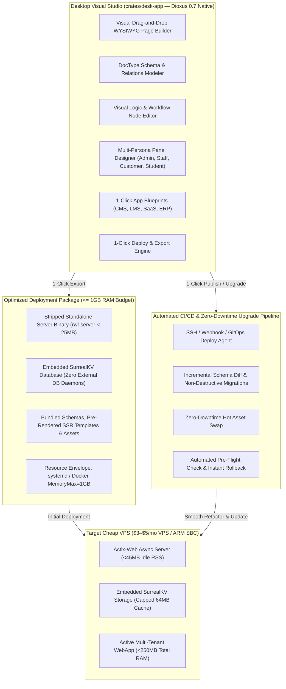

# ⚡ `rust-web-land` (`rwl`) — Universal No-Code WebApp Builder Platform & Operating Substrate

> **Build Visually on Desktop, Deploy to a $5 VPS in 1 Click**: The pure-Rust universal platform where anyone with **zero technical knowledge** can visually build, customize, and deploy any application (CMS, LMS, SaaS, ERP, or All-in-One) with **minimal effort**, **lean hardware requirements** (cheap $3–$5/mo VPS, strictly capped at **$\le 1\,\text{GB}$ RAM**), and **seamless scalability** via an automated **CI/CD deployment and incremental upgrade pipeline**.

[](https://www.rust-lang.org)
[](LICENSE)
[](Cargo.toml)
[](crates/rbench)
[](crates/rwl)

---

## 🏛️ Executive Strategy & The Three Pillars



1. **Visual Drag-and-Drop Desktop Studio (`crates/desk-app`, `crates/desk-components`)**: 
   A high-productivity visual studio built with native Dioxus 0.7. Design pages, forms, workflows, and role permissions visually without writing SQL or server boilerplate.
2. **Lean Operating Substrate & Persistence (`crates/rwl-net`, `crates/rwl-storage`)**: 
   Actix-Web async runtime paired with embedded SurrealDB 3.3 (SurrealKV storage engine). Boots in $<35\,\text{ms}$, runs at $<45\,\text{MB}$ idle RAM, and maintains strict multi-tenant isolation with zero external database daemons (no MariaDB, Redis, or PostgreSQL required).
3. **Automated CI/CD & Incremental Upgrade Engine (`crates/rwl`, `tools/doctype-diff`)**: 
   Package standalone production bundles with hard memory limits (`MemoryMax=1024M`). Push updates to live production servers with zero downtime using non-destructive bitemporal schema diffing, hot asset replacement, and automatic rollback on failure.

---

## 📦 Workspace Crate Topology (32 Crates)

The `rust-web-land` workspace is partitioned into 32 cohesive, decoupled crates covering tooling, framework, persistence, client runtime, business modules, and verification:

```
rust-web-land/
├── crates/
│   ├── rwl/                 # Unified CLI (init, studio, export, deploy, serve) & standalone runner
│   │
│   ├── rwl-meta/         # Dynamic DocType schema engine, SurrealQL DDL compiler, RBAC & naming series
│   ├── rwl-framework/    # Document lifecycle state machines, Rhai scripts, WASI 0.2 sandbox & AI dispatcher
│   ├── rwl-storage/      # Embedded SurrealDB 3.3 driver, CRDT vector clocks, CAS drive & envelope encryption
│   ├── rwl-net/          # Actix-web server, QUIC/HTTP3 gateway, WebSocket live broadcast & Subsonic streaming
│   │
│   ├── desk-app/            # Native desktop studio, multi-persona runtime shell (/portal, /worker, /factory, /admin)
│   ├── desk-components/     # Reactive Dioxus UI components, dynamic form engine, virtualized grid, Gantt & SPC charts
│   │
│   ├── erp-accounting/      # Zero-drift double-entry general ledger, multi-currency, payment gateways & Benford fraud guard
│   ├── erp-inventory/       # Real-time stock ledger, FIFO queue cost valuation, warehouse slotting & serial/batch tracking
│   ├── erp-manufacturing/   # Multilevel BOM explosions, MRP scheduling, MILP job shop solver & SPC quality control
│   ├── erp-trade/           # Commercial pricing rules, 3-way invoice matching, landed cost & WooCommerce migration
│   ├── erp-ppm/             # Critical Path Method (CPM/CCPM), ANSI/EIA-748 EVMS & 100k Monte Carlo risk engine
│   ├── erp-wms/             # 3D warehouse slotting, TSP pick path optimization, VDA 5050 AMR fleet dispatch
│   ├── erp-asset/           # Linear Referencing (LRS), Weibull reliability & RUL degradation, PTW & LOTO safety locks
│   ├── erp-software/        # ASC 606 revenue recognition, tiered SaaS subscriptions, SLA penalty ledgers
│   ├── erp-hr/              # Employee directory, biometric attendance logs, leave management & payroll
│   ├── erp-crm/             # Lead acquisition pipelines, deal tracking, weighted opportunity conversion scoring
│   ├── erp-quality/         # Inspection templates, Non-Conformance Reports (NCR) & CAPA remediation
│   ├── erp-support/         # SLA timers, escalation matrices & support gameplans
│   ├── erp-lending/         # Loan portfolios, reducing/compound interest accrual & amortization schedules
│   ├── erp-learning/        # Course syllabi, student enrollment tracking & quiz assessment engines
│   ├── erp-cms-core/        # Bare-metal #![no_std] edge CMS core, 63-byte AudioPlaybackPacket, CRC16-CCITT
│   ├── erp-cms/             # Visual Block Canvas AST, <10ms SSR, OTT Video & Master Audio Streaming CMS
│   ├── erp-scanner/         # High-throughput barcode, QR code & hardware scanner ingestion pipeline
│   ├── erp-scanner-core/    # Core scanner primitives and event bus abstraction
│   ├── erp-importer/        # High-volume batch data importer with type coercion and transactional rollback
│   ├── erpnext-plugin-sdk/  # Third-party app extension SDK with WASM/WASI plugin interface and DocType bindings
│   │
│   └── rbench/              # Site orchestration CLI, load tester, Debian/macOS/Windows package generator
│
├── tools/
│   ├── doctype-diff/        # Incremental schema differ for zero-downtime non-destructive migrations
│   ├── doctype-codegen/     # Rust struct and TypeScript definition generator from JSON DocTypes
│   └── stealth-scraper/     # Distributed market data, catalog synchronizer & catalog scraper
│
├── docs/                    # Architecture, PRD, user guides, setup manuals, TDD specifications
└── sdk/typescript/          # Strongly typed TypeScript client SDK for rust-web-land APIs
```

---

## 🚀 Quickstart & 1-Click Operations

### 1. Installation & CLI Setup

Build and run with standard Rust toolchain:

```bash
# Build the unified rust-web-land CLI binary
cargo build --release -p rwl

# Symlink or run directly
alias rwl="./target/release/rwl"
```

### 2. Scaffold a New Project from a Turnkey Blueprint

Initialize a ready-to-run project using any pre-tuned industry blueprint:

```bash
# Available blueprints: erp, cms, lms, saas
rwl init my-store --blueprint erp
cd my-store
```

### 3. Launch the Visual Builder Studio

Launch the visual WYSIWYG studio locally:

```bash
rwl studio --port 8080
```
Open **`http://127.0.0.1:8080/builder`** in your browser or run the native desktop workstation shell via `cargo run -p desk-app`.

### 4. Export a 1GB-Budgeted Production VPS Package

Generate a self-contained, pre-configured production deployment bundle:

```bash
rwl export --target vps --output ./deploy
```

The exported package contains:
- Stripped static server binary (`rwl-server` / `rwl-net`).
- Tuned `start.sh` launcher configuring embedded SurrealKV storage.
- Production `rust-web-land.service` systemd unit enforcing `MemoryMax=1024M` and `MemoryHigh=850M`.
- Optional `docker-compose.yml` with strict cgroup memory caps.

### 5. Deploy with Zero Downtime to Production VPS

Push updates and incremental schema migrations to your live production VPS:

```bash
rwl deploy --host 192.168.1.100 --port 8080 --token secret123
```

### 6. Run the Standalone Server

Start the production server directly with embedded SurrealKV:

```bash
rwl serve --port 8080 --host 0.0.0.0 --data-dir ./data/rust-web-land.db
```

---

## 🎨 10 Universal Blueprints & 100 Aesthetic Permutations

`rust-web-land` includes 10 complete vertical application suites, compiled to zero-allocation SSR HTML with $<10\,\text{ms}$ TTFB and reactive client-side hydration:

| # | Blueprint / Archetype | Route | Core Capabilities |
| :---: | :--- | :--- | :--- |
| **1** | **SVoD Cinema 4K Streaming** | `/templates/svod-streaming` | Tokenized DRM streaming, season playlists, SSAI ad pods, Stremio v1 addon |
| **2** | **LMS Academy & Certificates** | `/templates/lms-academy` | Course syllabus tree, video lessons, Typst Merkle-verified diplomas |
| **3** | **Digital Goods & Software** | `/templates/digital-goods` | ECDSA-signed software licenses, versioned downloads, instant license keys |
| **4** | **B2B Industrial Supply** | `/templates/b2b-industrial` | Net 60 terms, interactive 3D CAD viewer, tiered RFQ matrices, ZUGFeRD 2.2 |
| **5** | **B2C High-Volume Retail** | `/templates/b2c-retail` | 60+ FPS virtualized SKU grid, Three.js 3D customizer, instant cart settlement |
| **6** | **High-Frequency Trading** | `/templates/trading-exchange` | Sub-millisecond order book depth ladder, live trade tape, latency monitors |
| **7** | **Luxury Real Estate** | `/templates/real-estate-luxury` | Multi-estate showcase with virtual tour maps and mortgage calculator |
| **8** | **Healthcare Clinic** | `/templates/healthcare-clinic` | Doctor scheduling, triage calendar, HIPAA-compliant patient intake |
| **9** | **Fine Dining & Bistro** | `/templates/restaurant-culinary` | Interactive seasonal menus, table reservation engine, wine pairing selector |
| **10** | **Modern Global Newsroom** | `/templates/news-editorial` | Breaking news tickers, multi-edition articles, author columns, paywalls |

### 10 Instant Design Themes ($10 \times 10 = 100$ Permutations)

Switch aesthetics at runtime with zero recompilation via URL parameter (`?variant={name}`) or floating theme dock:

1. `awwwards`: Award-grade typography, kinetic motion, micro-interactions.
2. `cyberpunk`: High-contrast yellow/crimson, neon scanlines, HUD telemetry.
3. `vaporwave`: Dreamland gradients, frosted glassmorphism blur, ambient glow.
4. `retrowave`: 80s outrun chrome typography, analog CRT scanlines, LED VU meters.
5. `neonwave`: Cyber-retro electric cyan, perspective 3D grid, audio-reactive wave shaders.
6. `tasteful`: Obsidian dark theme, physics-based springs, clean visual hierarchy.
7. `brutalist`: Unfiltered bold borders, geometric badges, raw high-impact contrast.
8. `editorial`: Serif typography, paper-like warmth, broadsheet layout discipline.
9. `luxury`: Deep midnight tones, brushed champagne metallics, jewelry accents.
10. `monochrome`: Pure grayscale, stark crisp borders, terminal clarity.

---

## 🔒 Production Hardening & Battle-Tested Guarantees

| Invariant | Implementation | Guarantee |
| :--- | :--- | :--- |
| **VPS Resource Envelope** | `rwl export` & embedded SurrealKV | **Strictly $\le 1\,\text{GB}$ RAM**: $<45\,\text{MB}$ idle, $<250\,\text{MB}$ under full load |
| **Document Immutability** | `crates/rwl-net/src/v2_routes.rs` | **P0 Ledger Safety**: Direct modification of submitted docs (`docstatus == 1`) rejected |
| **Side-Channel Defense** | `crates/erp-accounting/src/payment_gateway.rs` | **Constant-Time Verification**: Webhook signatures verified in constant time |
| **JIT Optimization** | `crates/rwl-framework/src/wasmtime_sandbox.rs` | **SHA-256 JIT Module Cache**: Guest hooks reused across concurrent invocations |
| **Hot Ledger Indexing** | `crates/rwl-meta`, `crates/rwl-storage` | **Composite Index DDL**: Zero full-table scans on `gl_entries` and stock ledgers |
| **Zero Memory Leaks** | `crates/rwl-net/src/v2_routes.rs` | **Bounded FIFO Caches**: In-memory state bounded with oldest-key eviction |
| **Zero Decimal Drift** | `rust_decimal` across accounting & stock | **Exact Balance**: $\sum \text{Debit} - \sum \text{Credit} \equiv 0$ |

---

## 🧪 Verification & Quality Gate

```bash
# Verify compilation across all 32 workspace crates
cargo check --workspace

# Run complete workspace test suite (100% pass rate)
cargo test --workspace

# Verify crash recovery and zero-drift ledger integrity
cargo test -p rbench --test crash_recovery_tests

# Run performance golden tests (SLA1–SLA6 sub-millisecond cached get, streaming GL)
cargo test -p rbench --test golden_perf_tests

# Run dedicated security hardening test suite
cargo test -p rbench --test security_hardening_tests

# Enforce zero-warning linting and strict formatting
cargo fmt --check
cargo clippy --workspace --all-targets -- -D warnings
```

---

## 📚 Documentation & Technical Guides

- 🚀 [**3-Minute Quickstart Guide (`docs/quickstart_3min_guide.md`)**](file:///home/jrad/RustroverProjects/ERPNext_workspace/docs/quickstart_3min_guide.md)
- 🏛 [**System Architecture Specification (`docs/architecture.md`)**](file:///home/jrad/RustroverProjects/ERPNext_workspace/docs/architecture.md)
- 📜 [**Master Architectural Evolution Charter (`docs/master_charter.md`)**](file:///home/jrad/RustroverProjects/ERPNext_workspace/docs/master_charter.md)
- 📋 [**Product Requirements Document (`docs/prd.md`)**](file:///home/jrad/RustroverProjects/ERPNext_workspace/docs/prd.md)
- 🛠 [**Developer & Administrator Setup Guide (`docs/setup_guide.md`)**](file:///home/jrad/RustroverProjects/ERPNext_workspace/docs/setup_guide.md)
- 👤 [**Universal Operator & User Guide (`docs/user_guide.md`)**](file:///home/jrad/RustroverProjects/ERPNext_workspace/docs/user_guide.md)
- 🎨 [**Universal Templates & Theme Engine Guide (`docs/templates_guide.md`)**](file:///home/jrad/RustroverProjects/ERPNext_workspace/docs/templates_guide.md)
- 🧪 [**Test-Driven Development (TDD) Specification (`docs/tdd.md`)**](file:///home/jrad/RustroverProjects/ERPNext_workspace/docs/tdd.md)
- 🧪 [**End-to-End Testing & Verification Plan (`docs/e2e_testing_plan.md`)**](file:///home/jrad/RustroverProjects/ERPNext_workspace/docs/e2e_testing_plan.md)
- 📦 [**`rwl` CLI & Standalone Runner README (`crates/rwl/README.md`)**](file:///home/jrad/RustroverProjects/ERPNext_workspace/crates/rwl/README.md)
- 📝 [**Changelog & Release Notes (`CHANGELOG.md`)**](file:///home/jrad/RustroverProjects/ERPNext_workspace/CHANGELOG.md)
