# `rust-web-land` (`rwl`) — System Architecture & Engineering Specification

## 1. Executive Architectural Charter

`rust-web-land` (`rwl`) is a universal, no-code web application builder platform and planetary-scale enterprise operating substrate implemented entirely in pure Rust. It unifies visual drag-and-drop design on the desktop with high-efficiency deployment to low-cost Linux VPS hosts strictly capped at **$\le 1\,\text{GB}$ RAM**, eliminating foreign runtime daemons (no Node.js, Python, MariaDB, or Redis), interpreted scripting bottlenecks, and container bloat.

The platform is constructed on three foundational pillars:
1. **Desktop Visual Studio & UI Component Fabric ([Dioxus 0.7](https://dioxuslabs.com)):** Cross-platform visual studio (`crates/desk-app`, `crates/desk-components`) delivering WYSIWYG page building, dynamic DocType schema modeling, visual workflow nodes, and role-adaptive persona projections (`/portal`, `/worker`, `/factory`, `/approvals`, `/admin`).
2. **Asynchronous Network Substrate & Persistence ([Actix-web](https://actix.rs) & [SurrealDB](https://surrealdb.com)):** Multi-tenant HTTP/1.1, HTTP/2, HTTP/3, and WebSocket actor dispatchers with in-process automated ACME TLS certificate lifecycle management, paired with embedded SurrealKV storage running under $45\,\text{MB}$ idle RSS.
3. **Automated CI/CD & Incremental Upgrade Engine (`crates/rwl`, `tools/doctype-diff`):** 1-click deployment bundle exporter, non-destructive bitemporal schema diffing, hot asset replacement, and automated rollback mechanisms ensuring zero production downtime.

---

## 2. High-Level Substrate Topology & Delivery Pipeline

```mermaid
graph TD
    subgraph DesktopStudio["Desktop Visual Studio (Dioxus 0.7 Native)"]
        D1["Visual Drag-and-Drop Page Builder"]
        D2["DocType Schema & Relations Modeler"]
        D3["Visual Logic & Workflow Node Editor"]
        D4["Multi-Persona Panel Designer"]
        D5["1-Click Turnkey Blueprints (CMS, LMS, SaaS, ERP)"]
    end

    subgraph RWLTooling["rwl CLI & Pipeline Engine"]
        CLI1["rwl init: Blueprint Scaffolder"]
        CLI2["rwl studio: Local Visual Workbench"]
        CLI3["rwl export: 1GB Capped Package Generator"]
        CLI4["rwl deploy: Zero-Downtime Hot Deployer"]
        CLI5["doctype-diff: Non-Destructive Schema Migration"]
    end

    subgraph CorePlatform["Core Rust Substrate (32 Workspace Crates)"]
        Net["frappe-net: Actix-Web, QUIC/HTTP3, WebSockets, ACME"]
        Meta["frappe-meta: DocType Engine, DDL Compiler, RBAC"]
        Frame["frappe-framework: Lifecycle State Machines, WASI 0.2"]
        Storage["frappe-storage: Embedded SurrealKV, CRDT Mesh, CAS Drive"]
        Biz["Business Domains: Accounting, Inventory, Manufacturing, CRM, etc."]
    end

    subgraph TargetHost["Production Host ($3-$5/mo Linux VPS / ARM SBC)"]
        VPS1["Stripped Server Binary (<25MB)"]
        VPS2["Embedded SurrealKV Storage (Zero External DBs)"]
        VPS3["Systemd / Docker Envelope: MemoryMax=1024M"]
    end

    DesktopStudio --> RWLTooling
    RWLTooling --> CorePlatform
    CorePlatform --> TargetHost
```

---

## 3. Workspace Crates Topology (32 Crates)

The `rust-web-land` workspace organizes its capabilities across 6 decoupled functional tiers:

### 3.1 CLI & Application Pipeline
- **`rwl`**: Unified developer and operator CLI. Implements commands:
  - `rwl init`: Instant project bootstrapping from CMS, LMS, SaaS, and ERP blueprints.
  - `rwl studio`: Launches the visual drag-and-drop builder interface at `http://127.0.0.1:8080/builder`.
  - `rwl export`: Emits an optimized release bundle pre-tuned with systemd unit limits (`MemoryMax=1024M`).
  - `rwl deploy`: Pushes incremental updates to live VPS servers over authenticated HTTP/SSH.
  - `rwl serve`: Direct standalone production server execution with embedded SurrealKV.
  - `rwl status`: Real-time telemetry, memory usage, and health checks.

### 3.2 Framework & Core Substrate
- **`frappe-meta`**: Statically compiles declarative `DocTypeSchema` structs into `SCHEMAFULL` SurrealQL table definitions, field assertions, unique constraints, and foreign relations. Provides lock-free autoname series parsing (`NamingSeriesParser`) and AI schema synthesis (`AiSchemaSynthesizer`).
- **`frappe-framework`**: Rigid document lifecycle state machine (`validate` $\to$ `before_save` $\to$ `on_update` $\to$ `before_submit` $\to$ `on_submit` $\to$ `on_cancel`). Provides embedded Rhai dynamic scripting and WASI 0.2 Wasmtime sandbox with deterministic instruction fuel metering ($1,000,000$ operations limit) and linear memory bounds.
- **`frappe-storage`**: Multi-model SurrealDB 3.3 embedded driver with zero-leak connection pooling, SHA-256 content-addressable deduplicated drive (`DeduplicatedStorage`), CRDT vector clocks (`VectorClock`), durable offline outbox, and field-level AEAD envelope encryption (AES-256-GCM / ChaCha20-Poly1305).
- **`frappe-net`**: Primary transport gateway implementing Actix-Web HTTP/1.1 and HTTP/2, QUIC & HTTP/3 (`quic_h3_stream.rs`), LiveSync WebSockets (`live.rs`), automated in-process Let's Encrypt TLS (`AcmeGateway`), dynamic RBAC evaluation, Subsonic / OpenSubsonic API v1.16+ views, and OTT video streaming.

### 3.3 Visual Client & Desktop Studio
- **`desk-app`**: Cross-platform runtime shell built with native Dioxus 0.7. Employs polymorphic hardware abstraction (`MobileHardwareAbstractionLayer`) between Android JNI and W3C Web APIs, role-adaptive persona router (`/portal`, `/worker`, `/factory`, `/approvals`, `/admin`), and offline PWA service worker compiler.
- **`desk-components`**: Reactive UI component library providing dynamic form synthesis (`DocTypeForm`), virtualized data tables rendering up to 1,000,000 rows at sustained 60 FPS, interactive CPM Gantt charts, Nelson-rule SPC control viewers, 3D WMS warehouse slotting visualizers, and visual query builders.

### 3.4 Enterprise Business Domain Crates
- **`erp-accounting`**: Multi-book double-entry general ledger enforcing $\sum \text{Debit} - \sum \text{Credit} = 0$, Benford's Law fraud guard (`BenfordGuard`), enterprise printable document engine (`print_format.rs`), and payment gateway processor with automated double-entry GL settlement.
- **`erp-inventory`**: Real-time Stock Ledger Entries (SLE), SIMD-aligned FIFO cost valuation queues, hierarchical warehouse trees, and lot/serial number tracking.
- **`erp-manufacturing`**: Recursive multi-level BOM explosion, Mixed-Integer Linear Programming (MILP) job shop scheduler, and Statistical Process Control (`SpcEngine`).
- **`erp-ppm`**: Critical Path Method (CPM/CCPM), ANSI/EIA-748 Earned Value Management System (EVMS), and 100k-iteration Monte Carlo stochastic risk simulator.
- **`erp-wms`**: 3D volumetric slotting, TSP pick path optimization, GS1 SSCC-18 handling units, and VDA 5050 AMR fleet coordination.
- **`erp-asset`**: Linear Referencing Systems (LRS), Weibull Remaining Useful Life (RUL) predictive degradation, and cryptographic Permit-to-Work (PTW) / Lockout-Tagout (LOTO) interlocks.
- **`erp-software`**: ASC 606 5-step standalone selling price revenue recognition, graduated SaaS subscription tiers, and SLA penalty credit ledgers.
- **`erp-trade`**: Commercial cascading pricing rules, metered billing, landed cost allocation, automated 3-way invoice matching, and streaming WooCommerce catalog migration.
- **`erp-hr`**: Employee directory, biometric attendance logging, flexible salary rule matrix, and automated payroll slip generation.
- **`erp-crm`**: Multi-stage lead acquisition funnels, deal conversion state machines, and weighted opportunity scoring.
- **`erp-quality`**: Inspection templates, Non-Conformance Reports (NCR), and CAPA remediation workflows.
- **`erp-support`**: SLA response/resolution timers, escalation matrices, and support gameplans.
- **`erp-lending`**: Reducing-balance and compound interest accrual with exact-decimal amortization schedules.
- **`erp-learning`**: Course syllabi, lesson progression state machines, student enrollment, and quiz assessment engines.
- **`erp-cms-core`**: Bare-metal `![no_std]` wire telemetry packet (`AudioPlaybackPacket`) with CRC16-CCITT checksum for Cortex-M microcontrollers.
- **`erp-cms`**: Declarative `PageBlock` canvas AST, pre-allocated zero-allocation SSR HTML compiler ($<10\,\text{ms}$ TTFB), 10 prebuilt enterprise template suites with 10 aesthetic themes (100 permutations total), full OTT video streaming, and Master Audio Streaming CMS.

### 3.5 Scanning, Import & Extension SDK
- **`erp-scanner` & `erp-scanner-core`**: High-throughput barcode, QR code, and hardware scanner event pipeline.
- **`erp-importer`**: High-volume transactional data importer supporting CSV/JSON with type coercion and rollback.
- **`erpnext-plugin-sdk`**: Extension SDK with WASM/WASI plugin interfaces and DocType bindings.

### 3.6 Tooling & Quality Gate
- **`rbench`**: Multi-tenant site provisioning, packaging, and high-concurrency load testing harness.
- **`doctype-diff`**: AST-level schema comparison tool detecting added, modified, or removed DocType fields for non-destructive zero-downtime upgrades.
- **`doctype-codegen`**: Generates strongly typed Rust structures and TypeScript definitions directly from DocType definitions.
- **`stealth-scraper`**: Distributed market catalog synchronizer.

---

## 4. Production Hardening & Security Guarantees

1. **Strict 1GB VPS Memory Envelope**:
   - Standalone binary footprint: $< 25\,\text{MB}$.
   - Idle RSS: $< 45\,\text{MB}$.
   - Active full-stack multi-tenant workload: $< 250\,\text{MB}$.
   - Hardware target: $3–$5/mo VPS instances or low-power ARM single-board computers (Raspberry Pi 4/5, Orange Pi).
2. **P0 Document Immutability & Parameterized Bindings**:
   - Direct PUT modifications on submitted documents (`docstatus == 1`) are rejected with HTTP 400 Bad Request.
   - All dynamic SurrealDB mutations and lookups use parameterized bindings (`.bind(("name", name))`, `$doc`).
3. **Side-Channel Timing Attack Immunity**:
   - Webhook signature checks (Stripe, PayPal, HMAC) use constant-time slice comparison (`constant_time_eq_slices`).
4. **Wasmtime JIT In-Memory Module Cache**:
   - WebAssembly guest scripts are cached by SHA-256 bytecode hash, eliminating repetitive JIT compilation overhead.
5. **Hot Ledger Secondary Composite Indexes**:
   - `gl_entries`: indexed on `(account, posting_date)` and `(voucher_type, voucher_no)`.
   - `stock_ledger_entries`: indexed on `(item_code, warehouse)` and `(posting_date)`.
6. **Zero Memory Leaks & Bounded State**:
   - All in-memory maps (refresh tokens, RMA records, audio timelines, coupons, wishlists) are strictly bounded with oldest-key FIFO eviction.
7. **Exact Decimal Accounting**:
   - Complete absence of floating-point rounding errors through `rust_decimal` across general ledgers, stock transactions, and loan amortization.

---

## 5. Related Documentation & Guides

- 🚀 [**3-Minute Quickstart Guide (`docs/quickstart_3min_guide.md`)**](file:///home/jrad/RustroverProjects/ERPNext_workspace/docs/quickstart_3min_guide.md)
- 📜 [**Master Architectural Evolution Charter (`docs/master_charter.md`)**](file:///home/jrad/RustroverProjects/ERPNext_workspace/docs/master_charter.md)
- 📋 [**Product Requirements Document (`docs/prd.md`)**](file:///home/jrad/RustroverProjects/ERPNext_workspace/docs/prd.md)
- 🛠 [**Developer & Administrator Setup Guide (`docs/setup_guide.md`)**](file:///home/jrad/RustroverProjects/ERPNext_workspace/docs/setup_guide.md)
- 👤 [**Universal Operator & User Guide (`docs/user_guide.md`)**](file:///home/jrad/RustroverProjects/ERPNext_workspace/docs/user_guide.md)
- 🎨 [**Universal Templates & Theme Engine Guide (`docs/templates_guide.md`)**](file:///home/jrad/RustroverProjects/ERPNext_workspace/docs/templates_guide.md)
- 🧪 [**Test-Driven Development (TDD) Specification (`docs/tdd.md`)**](file:///home/jrad/RustroverProjects/ERPNext_workspace/docs/tdd.md)
- 🧪 [**End-to-End Testing & Verification Plan (`docs/e2e_testing_plan.md`)**](file:///home/jrad/RustroverProjects/ERPNext_workspace/docs/e2e_testing_plan.md)
