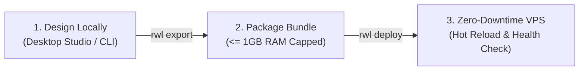

# 🚀 3-Minute Quickstart: Design on Desktop & Deploy to a $5 VPS

> **The Zero-DevOps Enterprise Substrate**: Build full-stack enterprise web applications visually on your desktop and deploy them to low-cost 1GB Linux VPS instances ($4–$5/month) with zero downtime, zero container bloat, and sub-millisecond database queries.

---

## 📋 The 3-Step Flow at a Glance



---

## Step 1: Design Locally in Desktop Studio (60 Seconds)

### 1.1. Scaffold Your Application
Initialize your platform with a turnkey industry blueprint:

```bash
# Available blueprints: erp, cms, lms, saas
rwl init my-enterprise --blueprint erp
cd my-enterprise
```

This creates a lightweight project configuration (`rwl.json`) pre-populated with standard DocTypes, visual page trees, and role-based permissions.

### 1.2. Launch Visual Studio
Launch the visual drag-and-drop builder:

```bash
rwl studio
```

Open your browser at **`http://127.0.0.1:8080/builder`** or use the native Dioxus desktop app:
- **Visual Page Canvas**: Drag-and-drop components (grids, charts, telemetry widgets, forms).
- **Form & Schema Builder**: Add custom fields without writing SQL or Python.
- **Visual RBAC Matrix**: Check boxes to assign permissions per role.
- **Theme Customizer**: Pick accent colors, dark/light modes, and typography.

---

## Step 2: Package the 1GB-Budgeted Production Bundle (30 Seconds)

Generate an ultra-compact production deployment package pre-configured for low-cost 1GB RAM VPS hosts:

```bash
rwl export --target vps --output ./deploy
```

### What's Inside the Bundle?
| Artifact | Purpose | Resource Limit |
|---|---|---|
| `frappe-net` | Stripped Rust release binary | Zero external runtime dependencies |
| `rust-web-land.service` | Production systemd service unit | `MemoryMax=1024M`, `MemoryHigh=850M` |
| `start.sh` | Automated pre-flight initialization script | Embedded SurrealKV auto-tuning |
| `docker-compose.yml` | Optional OCI container specification | Hard cgroup limits: `memory: 1024m` |

---

## Step 3: 1-Click Zero-Downtime Deploy & Incremental Sync (90 Seconds)

### 3.1. Initial Deploy
Copy your deployment bundle to your $5 VPS (Hetzner, DigitalOcean, Linode, Vultr):

```bash
# On your local machine:
scp -r ./deploy/* user@YOUR_VPS_IP:/opt/rust-web-land/

# On your VPS (one-time service launch):
ssh user@YOUR_VPS_IP
cd /opt/rust-web-land && chmod +x start.sh
sudo systemctl enable --now rust-web-land
```

Your server is now live at `http://YOUR_VPS_IP:8080` with:
- **Unified Desk Cockpit**: `/desk`
- **Customer / Supplier Portal**: `/portal`
- **Visual Studio**: `/builder`
- **Health Probe**: `/api/v2/admin/upgrade/status`

### 3.2. Continuous Incremental Updates (Zero Downtime)
Whenever you modify forms, redesign visual pages, or alter permissions in Desktop Studio, push updates directly from the CLI or Desktop App:

```bash
rwl deploy --host YOUR_VPS_IP --token your-deploy-token
```

### How the Zero-Downtime Engine Works:
1. **Cryptographic Patch Packaging**: Compares local schemas against live VPS status and generates a signed SHA-256 patch (`UpgradePatchBundle`).
2. **Pre-Flight Sanity Check**: VPS verifies cryptographic signature and validates non-destructive SurrealQL DDL statements.
3. **Atomic In-Memory Hot-Swap**: Page ASTs and schema caches swap in-memory with zero process restarts.
4. **Automated Health Check & Safe Rollback**: The client validates VPS health at `/api/v2/admin/upgrade/status`. If unhealthy, the server rolls back to the pre-upgrade snapshot automatically.

---

## ⚡ Summary of Unified CLI Commands

| Command | Action |
|---|---|
| `rwl init <name> --blueprint <type>` | Scaffold application from template (`erp`, `cms`, `lms`, `saas`) |
| `rwl studio [--port 8080]` | Open native visual builder and desk interface |
| `rwl export --target vps` | Package 1GB RAM capped production deployment bundle |
| `rwl deploy --host <ip> --token <tok>` | Push incremental zero-downtime updates to production VPS |
| `rwl serve [--port 8080]` | Start standalone server with embedded SurrealKV |
| `rwl status` | Inspect memory envelope, engine health, and active endpoints |
